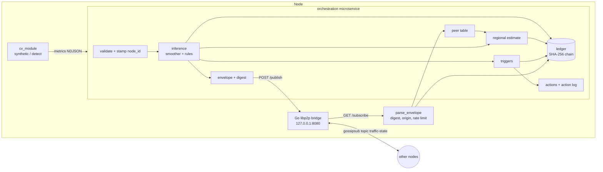

# Architecture

## Data flow (one interval)
1. P1 emits a metrics message (contract `metrics`, 0.2.0).
2. The microservice validates it and replaces `node_id` with the node's libp2p peer ID.
3. P2 turns it into a smoothed local state. The state is written to the ledger, wrapped in a signed-by-digest envelope and broadcast.
4. Peer envelopes arrive through the bridge: size, JSON, schema, digest, origin == authenticated sender, rate limit, de-duplication, then ledger and peer table.
5. P2 merges the local state with fresh peers into a regional estimate (ledger only).
6. Triggers evaluate the configured scope; alerts and clears are written to the ledger first, then dispatched.

## Repo layout (as built)
`contracts/`, `orchestration/`, `inference/` (root package), `cv_module/` (root package), `p2p-networking/`, `scripts/`, `docs/`.
This replaces the `cv-module/src` and `inference-module/src` paths in the original plan.

## Failure behaviour
| Failure | Behaviour |
|---|---|
| Go bridge down | Publish fails fast (circuit breaker); ledger, inference and triggers keep running. |
| Bridge restart (`boot_id` change) | Client resets its cursor and re-reads; duplicates are dropped by `message_id`. |
| Peer ID changed | Microservice exits with code 3 and the container restarts. |
| Malformed or spoofed peer message | Rejected and counted. Nothing reaches the ledger. |
| Flooding peer | Token-bucket rate limit per peer and globally. |
| Ledger tampering | `verify_chain`, optionally with an external anchor, reports the bad entry. |